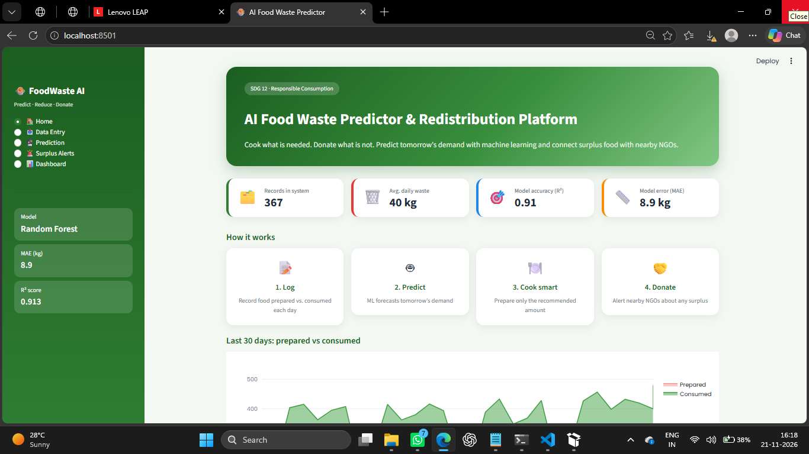
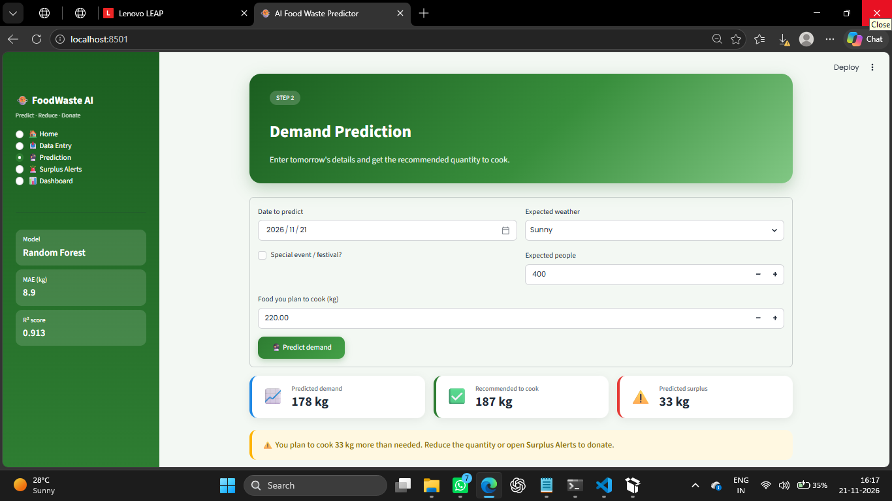
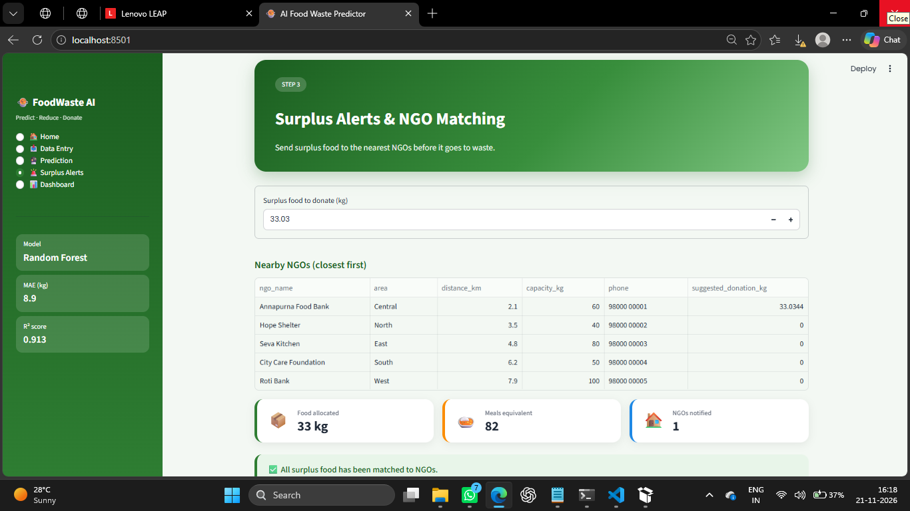
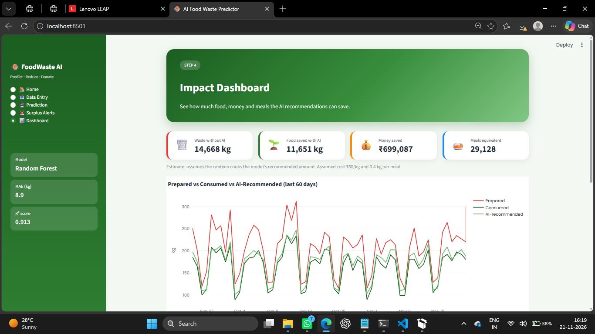

# 🍲 AI Food Waste Predictor & Redistribution Platform

> Cook what is needed. Donate what is not.

**SDG 12: Responsible Consumption and Production**

An AI-powered web app that predicts daily food demand for canteens, hostels and
restaurants, recommends how much to cook, and alerts nearby NGOs when surplus
food is expected.

---

## 📌 Problem Statement
Canteens, hostels and restaurants often cook more food than they actually need.
The extra food is thrown away, wasting money and resources, while NGOs and
shelters nearby struggle to feed people. There is no simple tool that helps
kitchens plan quantities and quickly connect surplus food with those in need.

## 🎯 Objective
Reduce food waste by using machine learning to forecast demand, and make it easy
to redistribute any leftover food to nearby NGOs.

## 💡 Solution
1. Staff log how much food was prepared and consumed each day.
2. A Random Forest model learns patterns (day of week, weather, events, number of people).
3. The app predicts tomorrow's demand and recommends the quantity to cook.
4. If surplus is expected, the closest NGOs are listed with suggested donation amounts.
5. A dashboard shows food saved, money saved and meals equivalent.

## ✨ Features
- **Data Entry:** add records manually or upload a CSV
- **Demand Prediction:** ML forecast with recommended cooking quantity
- **Surplus Alerts:** NGO matching by distance and capacity
- **Impact Dashboard:** interactive charts, food saved, money saved, meals equivalent
- **Auto-retraining:** the model updates when new data is added

## 🖼️ Screenshots
| Home | Prediction |
|------|------------|
|  |  |

| Surplus Alerts | Dashboard |
|----------------|-----------|
|  |  |

## 🛠️ Tech Stack
| Area | Technology |
|------|-----------|
| Language | Python |
| Machine Learning | scikit-learn (Random Forest) |
| Data | Pandas, NumPy |
| Web App | Streamlit |
| Visualization | Plotly |
| Version Control | Git & GitHub |

## 🚀 Run Locally
```bash
git clone https://github.com/lprisha007-eng/food-waste-predictor.git
cd food-waste-predictor
pip install -r requirements.txt
streamlit run app.py
```
Demo data and the NGO list are generated automatically on first run in the `data/` folder.

## 📁 Project Structure
```
food-waste-predictor/
├── app.py              # main Streamlit app (UI + model)
├── requirements.txt    # dependencies
├── .streamlit/
│   └── config.toml     # theme settings
├── screenshots/        # app screenshots
└── README.md
```

## 📊 Model
- Algorithm: Random Forest Regressor (200 trees)
- Features: day of week, special event, weather, number of people
- Target: food consumed (kg)
- Evaluation: MAE and R² on a 20% test split (shown in the app sidebar)

## ⚠️ Note
The dataset is **simulated** for demonstration. For real use, replace
`data/food_data.csv` with actual canteen records using the same columns.

## 🔮 Future Scope
- Mobile app for NGOs and kitchen staff
- Real NGO API integration with SMS / WhatsApp alerts
- IoT smart bins to measure waste automatically
- Live weather API and deep learning forecasting
- Multi-canteen support with user login

## 👩‍💻 Author
**YOUR NAME**
Capstone Project: Artificial Intelligence | Lenovo LEAP
